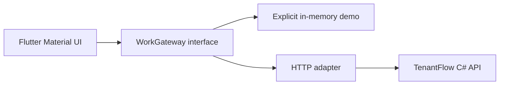
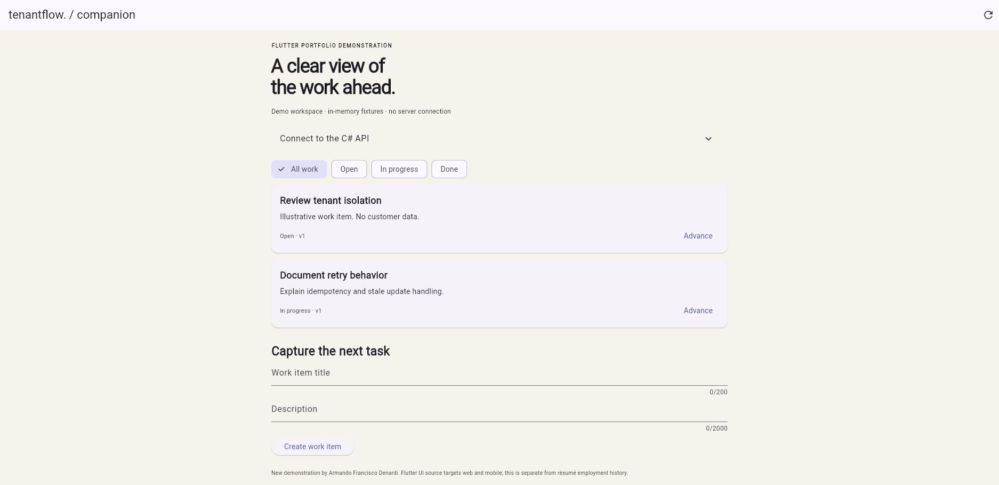

# TenantFlow companion — Flutter + C# API

A **new portfolio demonstration** by Armando Francisco Denardi, separate from employment history. Flutter is an additional sample technology; the professional mobile experience in the résumé is .NET MAUI and Xamarin.Forms.

## Run

Requires Flutter 3.47.8 stable / Dart 3.13.7 (the validated toolchain).

```sh
flutter pub get
flutter analyze
flutter test
flutter run -d chrome --web-port 5090 --web-hostname 127.0.0.1
```

The app starts with clearly labeled, in-memory demo data. It does not contact a server until you open **Connect to the C# API** and choose **Connect API**. Start [TenantFlow](https://github.com/kawmy/tenantflow-dotnet) in Development on port 5088, then use origin `http://127.0.0.1:5088` and development fixture key `tenant-alpha-key`. These published keys identify synthetic local tenants; they are not production credentials. The API allows only the two documented localhost origins on port 5090 in Development.

For an Android emulator, generate platform scaffolding with `flutter create --platforms=android,ios .` and connect to host origin `http://10.0.2.2:5088`, with a development-only reachable API binding. Platform signing, transport policy, device networking and production authentication must be configured for a native release. Android/iOS builds and physical-device operation have not been validated. The committed Flutter UI and client are platform-independent; the executed build is web.

## Architecture and behavior



- `work_item.dart`: typed work-item decoding and a create session that preserves the same idempotency key when retrying an unchanged request.
- `gateway.dart`: injectable HTTP client, tenant fixture header, bounded timeouts, server-side ETag concurrency, explicit authorization/conflict error messages. No automatic mutation retries.
- `main.dart`: loading/error/empty states, status filters, task creation and status transitions. A stale update asks the user to refresh instead of silently replacing newer server state.
- `test/`: HTTP contract, idempotency-key lifecycle, malformed response, optimistic concurrency and widget interaction coverage.

## Boundaries

API keys stay in memory and are not persisted. The app contains no real patient, payment, employer, or customer data. Demo mode is not an offline synchronization implementation. Production mobile delivery would require user authentication, secure token storage, telemetry redaction, platform transport policy, and an explicit synchronization design.

`flutter build web --release` creates an independently hostable static app under `build/web`. GitHub Pages can serve that build; it cannot run the C# API. See `VALIDATION.md` for the checks actually executed.

Reference: [Flutter web build and deployment](https://docs.flutter.dev/deployment/web).

## Live demonstration

[Try the companion in your browser](https://kawmy.github.io/demos/tenantflow/). The hosted demo uses synthetic in-memory data.



